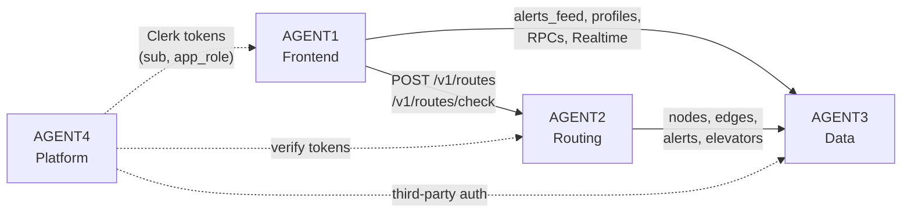

# ClearPath team guide

The ClearPath work is split into four workstreams. Each of us takes one and runs a coding agent on it. This page covers who does what, how the lanes connect, and how to get started.

**Read in this order:** this page → [AGENTS.md](../AGENTS.md) (shared rules) → your `AGENTn.md` → [README.md](../README.md) (the product spec).

---

## Who does what

| Agent | Workstream | Teammate | Owns | One-line mission |
|---|---|---|---|---|
| [AGENT1](AGENT1.md) | **Frontend** | _TBD_ | `apps/mobile/` | Every screen, accessible to VoiceOver and TalkBack users |
| [AGENT2](AGENT2.md) | **Routing service** | _TBD_ | `services/routing/` | Profile-aware, barrier-aware routes that explain themselves |
| [AGENT3](AGENT3.md) | **Data & Supabase** | _TBD_ | `supabase/`, `data/campus/` | Schema, security, alert trust rules, and the hand-mapped campus graph |
| [AGENT4](AGENT4.md) | **Platform, auth & quality** | _TBD_ | CI, `Makefile`, `docs/`, Clerk, hosting | Keep everyone unblocked, make it work end to end, run the usability study |

### AGENT1: Frontend

Builds the Expo app: sign-in, travel profile, live alert map (with a list alternative), alert detail and voting, two-tap reporting, elevator board, route options, navigation with mid-route reroute, and the demo-mode panel. Owns the accessibility checklist on every screen. Works against fixtures until the backend lands.

### AGENT2: Routing service

Builds the Go API: snaps points to the graph, runs A* with a cost function per travel mode, avoids live barriers, and returns 2–3 ranked routes, with notes that explain why a route doesn't fit ("Stairs at Turlington"). Also builds the mid-route check that powers rerouting. **First priority:** a basic walking route, so AGENT1 can draw something real.

### AGENT3: Data & Supabase

Writes the RLS policies and the RPCs the app calls (`report_alert`, `vote_alert`, `set_elevator_status`, demo helpers), which hold the trust rules: 4-hour expiry, "still there" extensions, two "cleared" votes to resolve, and Facilities verification. Hand-maps the demo zone (Library West, Marston, Turlington, CSE) into GeoJSON with stairs, slopes, surfaces, and elevators. **First priority:** RLS and sample data, so the others have something to read.

### AGENT4: Platform, auth & quality

Sets up Clerk and shares keys, gets CI green, makes `make dev` work from a clean clone, deploys the hosted environment, reviews every UI PR for accessibility and every contract change for both sides, and runs the usability study. Picks up frontend overflow once M1 is done. **First priority:** Clerk, because nobody can sign in until it exists.

---

## How the lanes connect



Every arrow is a **contract** with one owner. AGENTS.md → Contracts lists them all and explains how to change one. The short version: change both sides in one PR, update the README, and get a review from whoever consumes it.

---

## Milestones

| | Done when | Critical path |
|---|---|---|
| **M0: Boilerplate** ✅ | Repo scaffolded, contracts stubbed, tests pass | done |
| **M1: Walking skeleton** | Sign in → see alerts on the map → request a route → it draws | AGENT4 Clerk → AGENT3 RLS + samples → AGENT2 basic route → AGENT1 map + route |
| **M2: v1 features** | Every v1 item in README → Scope and roadmap works in the demo zone | All lanes in parallel |
| **M3: Study-ready** | Accessibility checklist passes everywhere, demo mode is reliable, usability sessions run | AGENT1 + AGENT4 |

Unblocking others comes before your own feature work.

---

## Getting started

### 1. Set up the repo

```bash
git clone <repo-url> clearpath && cd clearpath
pnpm install
cp apps/mobile/.env.example apps/mobile/.env
cp services/routing/.env.example services/routing/.env
# fill both in with the keys AGENT4 shares (never commit them)
supabase start && make seed
make test
```

Prerequisites: Node 20+, pnpm, Go 1.25+, Docker, Supabase CLI, and Expo Go on your phone.

### 2. Start your agent

Point your agent at the repo and give it this kickoff prompt, with your number filled in:

```text
You are AGENT<N> on the ClearPath project.

Before doing anything, read these in order:
1. AGENTS.md (shared rules, contracts, definition of done)
2. agents/AGENT<N>.md (your lane, files you own, your backlog)
3. README.md (the product spec; it wins any disagreement)

Work only in the files your lane owns. Take the first unchecked item
in your current milestone, and find related stubs with
`grep -rn "TODO(<your tag>)" .`. Plan before you code, write tests with
the feature, and run `make lint test` before you call anything done.
If a task needs a contract change or looks out of scope, stop and ask me.
```

Tags: AGENT1 `frontend`, AGENT2 `routing`, AGENT3 `data`, AGENT4 `platform`.

### 3. Work loop

1. Branch: `feat/<short-name>`, `fix/<short-name>`, or `data/<short-name>`.
2. Have your agent take one backlog item and finish it to the definition of done (AGENTS.md → section 6).
3. **Review what it wrote before you push.** You're responsible for your PR, not the agent.
4. Open a small PR. Link the requirement (`R1`–`R6`). For UI, add a screenshot and the accessibility note. If it unblocks someone, say so.
5. Get one approving review, then merge.
6. Check off the item in your `AGENTn.md`.

---

## Ground rules (the short list)

- Stay in your lane. Need something from another lane? Ask its owner.
- Never commit `.env` files or keys.
- Never hand-edit `supabase/seed.sql` or a merged migration.
- Never show status by color alone. Accessibility is part of done, not a polish pass.
- No new dependencies without a decision record in `docs/decisions/`.
- Don't build anything on the README's "Out of scope for v1" list.
- When in doubt, ask in the team chat before your agent guesses.
